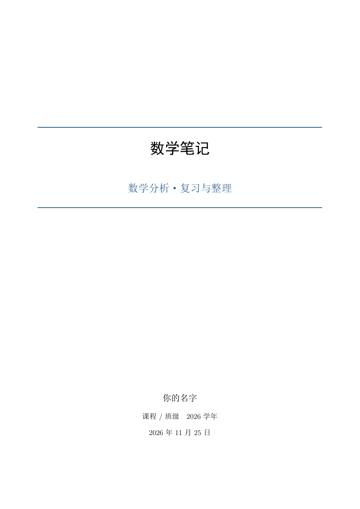
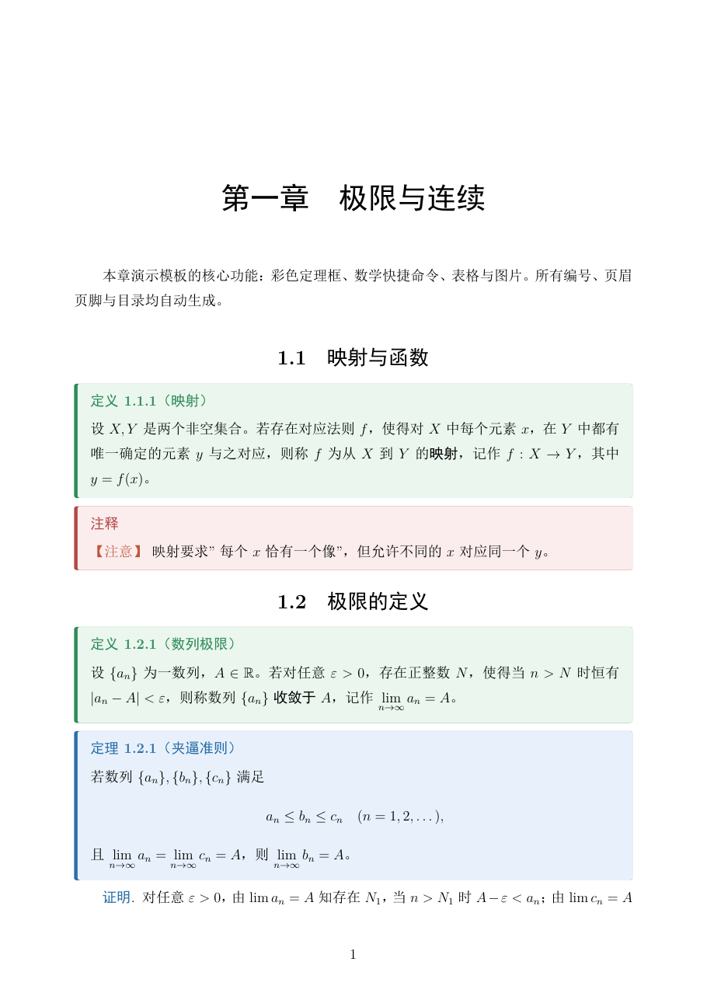
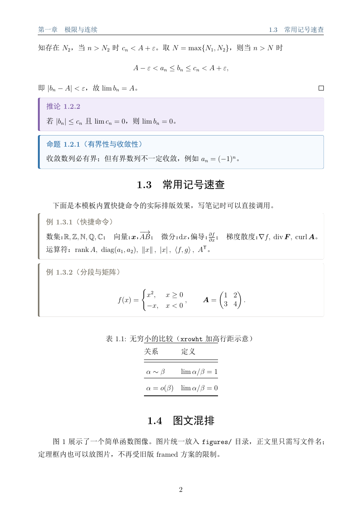
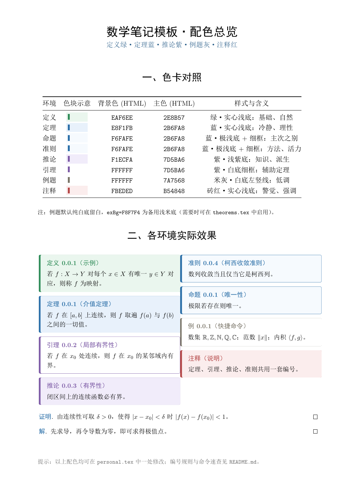

# latex template for math notes

> **Language / 语言**：**中文** | [English](README_EN.md)

一套为数学笔记写作设计的 LaTeX 模板：彩色定理环境（可跨页、框内可插图）、按章节组织、中英文一键切换。所有个人设置收拢在 **一个文件** `personal.tex`，写笔记时只需维护章节文件。

**目录**（点击跳转）：[效果预览](#preview) · [快速开始](#quickstart) · [真人怎么写](#human) · [AI 怎么用](#ai) · [配置与维护](#maintain) · [优缺点](#proscons) · [常见问题](#faq) · [结构与命令速查](#reference)

---

<a id="preview"></a>
## 一、效果预览

**封面**（`preview/page-1.png`）



**定理框与彩色环境**（`preview/page-4.png`）



**公式、表格与插图**（`preview/page-5.png`）



**5 大色系配色总览**（`preview/配色效果图.png`，[PDF 版](preview/配色效果图.pdf)）



完整 6 页示例成品见 [main.pdf](main.pdf)，各页大图在 [`preview/`](preview/) 目录。

---

<a id="quickstart"></a>
## 二、快速开始

**环境要求**：TeX Live 2022+（已在 2025 验证），编译引擎 **XeLaTeX**。Windows 用户安装 TeX Live 后可直接双击 `compile.bat`。

**三步出稿**：

```bash
# 1. 改 personal.tex：标题、姓名、课程、学期（配色和定理名一般不用动）

# 2. 编译两遍（第一遍生成目录，第二遍解析引用）
xelatex main.tex
xelatex main.tex

# 3. 打开 main.pdf
```

> 为什么两遍？第一遍把 `\label` / 目录写入 `.aux`，第二遍才能正确显示交叉引用和页码。引用显示 `??` 时再跑一遍即可。

---

<a id="human"></a>
## 三、真人怎么写

### 1. 新建一章

1. 把 `chapters/00-template/` 复制成 `chapters/02-你的主题/`（编号顺着排）。
2. 编辑里面的 `chap.tex`，写 `\chapter{章节名}` 和正文。
3. 在 `main.tex` 中取消对应 `\include{chapters/02-你的主题/chap}` 的注释。
4. 写单章时可在该章目录内单独运行 `xelatex chap.tex` 快速预览（模板内置判断，不会重复加载导言区）。

### 2. 用环境而不是手动加粗

```latex
\begin{definition}[连续]
  若 $\lim_{x\to x_0}f(x)=f(x_0)$，则称 $f$ 在 $x_0$ 连续。
\end{definition}

\begin{theorem}[介值定理]
  若 $f$ 在 $[a,b]$ 上连续，则 $f$ 取遍 $f(a)$ 与 $f(b)$ 之间的一切值。
  \label{thm:ivt}
\end{theorem}

由定理~\ref{thm:ivt} 可得……
```

所有环境都接受可选标题 `[...]`，可放公式、`\label`，可跨页，框内可插图。

### 3. 编号规则

| 环境 | 编号 | 说明 |
| --- | --- | --- |
| `definition` / `proposition` / `example` | 各自独立 | 按节编号，如 定义 1.2.1 |
| `theorem` / `lemma` / `corollary` / `criterion` | 共用一套 | 定理、引理、推论、准则连续编号 |
| `remark` / `proof` / `solution` | 不编号 | 可带可选标题 |

### 4. 图片

图片统一放 `figures/`，正文只写文件名：

```latex
\begin{figure}[htbp]
  \centering
  \includegraphics[width=0.62\linewidth]{example-curve.png}
  \caption{函数图像}
\end{figure}
```

---

<a id="ai"></a>
## 四、AI 怎么用

这套模板对任何 AI 助手都适用——ChatGPT、Claude、Gemini、Cursor、Copilot 或你惯用的编程 Agent 都可以。AI 不依赖任何专用插件：只要让它先读懂本仓库的约定，就能按模板写内容。

### 第一步：让 AI 先读两个文件

把下面两个文件提供给 AI（上传、贴内容或让它读取均可），它就能掌握全部约定：

1. 本使用手册 `README.md`（环境语义、编号规则、命令、维护方式）
2. 完整示例章 `chapters/01-demo/chap.tex`（各种环境的真实写法）

然后直接下达任务即可，例如：

- **"按这个模板写一篇《实数的完备性》笔记"** —— AI 会复制空白章模板、按环境规则写正文、加好 `\include`、编译并渲染预览。
- **"帮我把这段讲义整理成 LaTeX 笔记"** —— 贴入文字/公式，AI 转成 `definition`/`theorem` 等环境并放进章节。
- **"给我的笔记加一个拉格朗日中值定理的例题"** —— AI 定位对应章节，用 `example` + `solution` 追加。
- **"把我的笔记改成英文版并编译"** —— AI 把 `\Englishfalse` 改成 `\Englishtrue`，正文同步翻译成英文。
- **"编译我的数学笔记并检查错误"** —— AI 跑两遍 xelatex、检查日志、报告问题。

### 给 AI 的提示词模板（可直接复制）

```
请按我提供的 github.com/fairyland-town/latex-template-for-math-notes 模板写一份数学笔记。
先阅读 README 和 chapters/01-demo/chap.tex，再遵守以下约定：
1. 用模板已有环境，不要自己造框：定义用 definition，定理/引理/推论/准则
   用 theorem/lemma/corollary/criterion（这四类共用编号），命题与例题独立编号，
   注释/证明/解不编号；所有环境都支持可选标题 []。
2. 个人配置只改 personal.tex；正文写在 chapters/NN-主题/chap.tex，
   并在 main.tex 中加对应的 \include。
3. 数学符号优先用模板命令：\R \Z \bs{} \d \pd{}{} \norm{} \inner{}{} \pmat 等。
4. 图片放 figures/，正文只写文件名；插图用 TikZ 生成后转 PNG。
5. 编译用 xelatex 跑两遍；语言开关在 personal.tex 的 \Englishfalse/\Englishtrue。
```

### AI 能做的具体事

1. **写章节**：遵守环境语义（定义用 `definition`、定理用 `theorem`）、编号与 `\label` 规则。
2. **生成插图**：用 TikZ `standalone` 生成 PDF 再转 PNG，放进 `figures/`（要 `\clip` 限定画布）。
3. **编译与排错**：双遍编译、查 `LaTeX Error`、修 `??` 引用。
4. **批量整理**：把多段讲义拆成多章，统一命令与配色。
5. **改配置**：换色只改 `personal.tex` 第 2 节，环境改名改对应 `\ifEnglish` 分支。

> **AI 写作的边界**：语言开关只切换模板结构文字，**不会翻译正文**。让 AI 写英文笔记时，要明确要求它把正文也写成英文。

### 可选：WorkBuddy 用户

若你恰好使用 WorkBuddy，作者提供了一个配套 Skill（`personal-math-notes`），把它放到 `~/.workbuddy/skills/personal-math-notes/` 后，可直接说"用我的数学笔记模板写一篇 XX 笔记"，Skill 会自动按上述约定执行。这不是使用模板的前提——任何 AI 工具用上面的方法都能达到同样效果。

---

<a id="maintain"></a>
## 五、配置与维护

### 改什么、改哪里

| 需求 | 文件 | 位置 |
| --- | --- | --- |
| 标题 / 作者 / 课程 / 学期 | `personal.tex` | 第 1 节对应语言分支 |
| 定理环境中文/英文名 | `personal.tex` | 第 3 节 `\nmDef` 等 |
| 中英文切换 | `personal.tex` | 第 0 行 `\Englishfalse` / `\Englishtrue` |
| 换配色 | `personal.tex` | 第 2 节十六进制色值 |
| 盒子边框 / 底色分级 | `config/theorems.tex` | `defstyle` / `thmstyle` 等（一般不动） |
| 新增数学命令 | `config/mathmacros.tex` | 末尾追加 `\newcommand` |
| 页面 / 行距 / 页眉 | `config/packages.tex` | 一般不动 |

### 换色一句话说明

只改 `personal.tex` 第 2 节的色值，例如 `thmMain` 控制定理蓝、`exMain` 控制例题米灰；主色 `themeMain` 控制封面、页眉与超链接。盒子的实心底/细框分级在 `config/theorems.tex`，不用动。

### 重新生成配色图

```bash
cd preview
xelatex color-scheme.tex     # 生成 color-scheme.pdf
pdftoppm -png -r 130 -singlefile color-scheme.pdf 配色效果图
```

### 版本维护（GitHub）

```bash
# 日常改完推送
git add -A
git commit -m "说明改了什么"
git push origin main

# 换机器拉最新
git clone https://github.com/fairyland-town/latex-template-for-math-notes.git
```

建议每写完一章提交一次，章节文件是纯文本，diff 非常清晰。

### 如何给 AI 加新约定

把通用约定集中写在仓库根目录的 `AGENTS.md`（已提供），大多数 AI 编程工具会自动读取它；其他 AI 工具只要把该文件一并提供给 AI 即可。模板本身若改动，记得同步更新 `README.md`、`AGENTS.md` 和示例章。

---

<a id="proscons"></a>
## 六、优缺点

**优点**

1. **单一配置入口**：个人信息、配色、定理名全在 `personal.tex`，写正文时不被配置干扰。
2. **定理框稳定**：`tcolorbox` 支持跨页、框内放图，不会像老式 `framed` 那样在长定理处报错。
3. **视觉层次清楚**：5 大色系 + "同色不同形"，主次环境一眼可分。
4. **中英双语一键切换**：封面、环境名、章节标题、目录名、日期同步切换，不用维护两套模板。
5. **单章可独立编译**：写某章时不必编译整本书，迭代快。
6. **AI 友好**：自带 `AGENTS.md` 约定与可复制提示词，任何 AI 助手都能按同一套规则写作、插图、排错。
7. **纯文本、可版本管理**：章节是 `.tex` 文本，Git diff 清晰，可长期维护。

**缺点 / 限制**

1. **编译门槛**：需要安装 TeX Live（体积较大），且必须用 XeLaTeX；`compile.bat` 目前仅 Windows。
2. **需编译两遍**：每次改完跑两遍才能让目录与引用正确。
3. **中文字体依赖环境**：不同系统缺字体可能导致字形差异，建议在装有完整中文字体的 TeX Live 环境下使用。
4. **语言开关不翻译正文**：切换只影响结构文字，正文需自行写成对应语言。
5. **配色固定为 5 色系**：想加第 6 种颜色需同时改 `personal.tex` 的颜色定义和 `theorems.tex` 的样式（有 LaTeX 基础才方便）。
6. **不适合超长文档**：几百页时编译会明显变慢，建议按章拆分预览。

---

<a id="faq"></a>
## 七、常见问题

**Q：引用显示 `??`？** 跑第二遍 xelatex；仍不行就删掉 `.aux` 再编译两遍。

**Q：定理框跨页时标题/样式异常？** 本模板已启用 `breakable`，正常跨页；若自定义了样式，确认保留了 `breakable`。

**Q：英文版出现 `Chapter1` 没有空格？** 已修复（`chapter/name` 带 `\space`）；若自己改过 `\ctexset`，记得保留空格。

**Q：想加一个自己的定理类环境？** 在 `config/theorems.tex` 用 `\newtcolorbox` 仿照现有环境写，样式沿用 `thmstyle` 等；编号计数器规则见该文件顶部注释。

**Q：编译报错说找不到宏包？** 用 TeX Live 2022+ 并运行 `texlive-update` 更新宏包；本模板用到 `ctex`、`tcolorbox`、`amsthm` 等常见包。

---

<a id="reference"></a>
## 八、结构与命令速查

```
latex-template-for-math-notes/
├── main.tex              # 主文件：编译全部章节
├── personal.tex          # ★ 唯一需要改的个人配置
├── AGENTS.md             # 给 AI 助手的通用约定（任何工具可用）
├── compile.bat           # 一键编译脚本（Windows）
├── config/
│   ├── packages.tex      # 宏包与页面设置
│   ├── mathmacros.tex    # 数学快捷命令库
│   ├── theorems.tex      # 彩色定理环境
│   └── cover.tex         # 封面 + 前言 + 目录 + 页眉页脚
├── chapters/
│   ├── 01-demo/chap.tex      # 完整示例章
│   └── 00-template/chap.tex  # 空白章模板
├── figures/              # 图片统一放这里
├── preview/              # 示例页预览图 + 配色效果图
└── main.pdf              # 示例成品
```

常用数学命令：

| 类别 | 命令 |
| --- | --- |
| 数集 | `\R \Z \N \Q \C` |
| 向量 | `\bs{A}` / `\ora{AB}` |
| 微积分 | `\d` `\pd{f}{x}` `\grad` `\dive` `\rotn` `\curl` |
| 运算符 | `\rank \diag \tr \dist \sgn \Var \Cov \argmax \argmin \esssup` |
| 范数/取整 | `\abs{} \norm{} \inner{}{}` `\ceil{} \floor{}` |
| 记号 | `\defeq` `\pll` `\ind{A}` `\dx{x}` `A^{\T}` |
| 环境 | `ca`(cases) `pmat` `bmat` `vx`，可带 `[行高倍数]` |
| 表格 | `\tabincell{c}{a\\b}` `\xrowht[20pt]` |
| 提醒 | `\todo{重点}` `\note{批注}` |

自定义新命令：在 `config/mathmacros.tex` 末尾追加 `\newcommand{\你的命令}[参数个数]{定义}`，全篇可用。

---

**仓库**：https://github.com/fairyland-town/latex-template-for-math-notes
