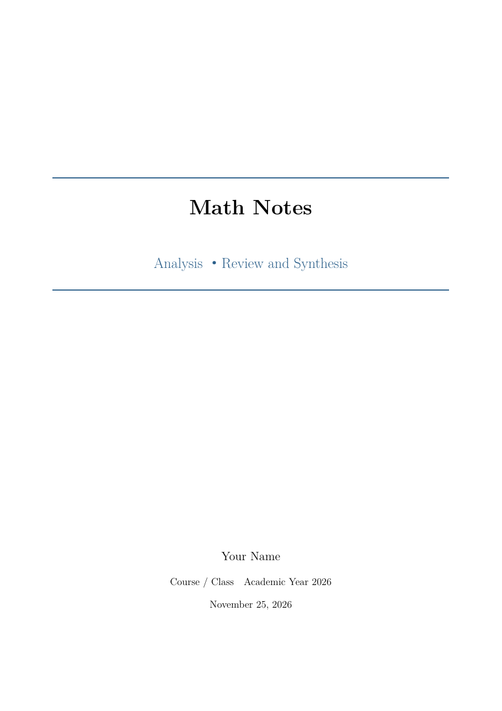
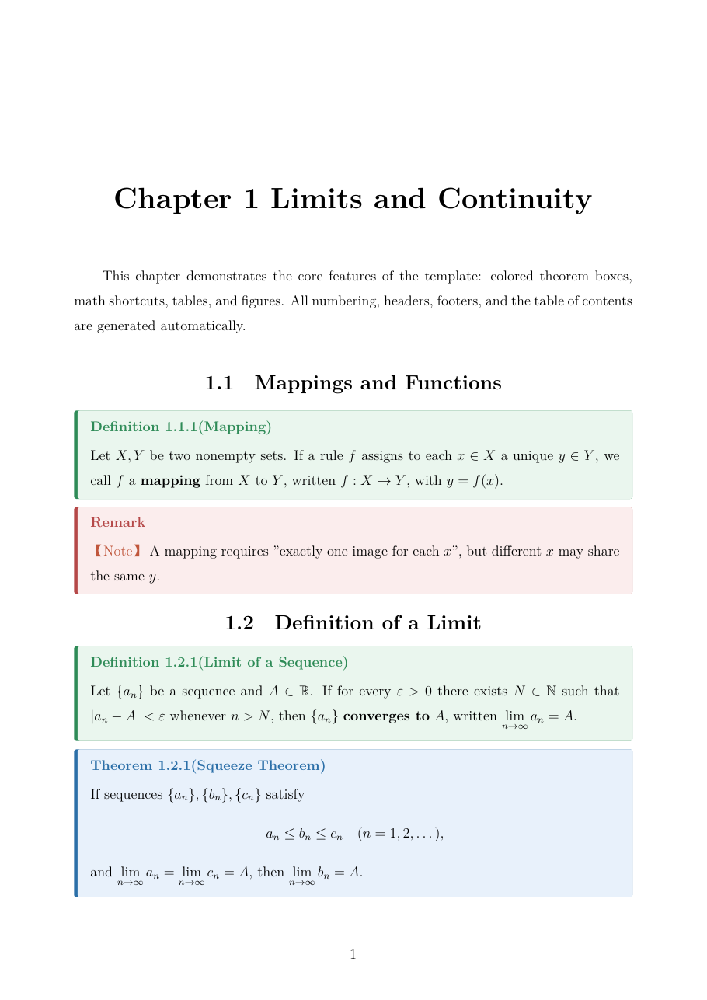
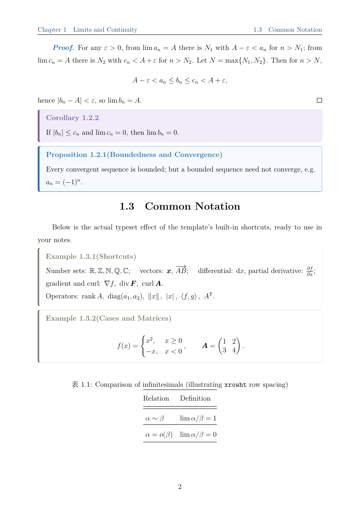
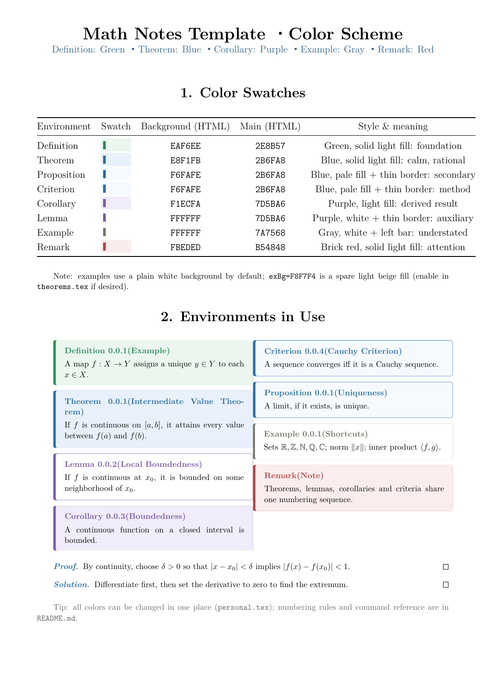

# latex template for math notes

> **Language / 语言**：[中文](README.md) | **English**

A LaTeX template designed for writing math notes: colored theorem environments (page-breakable, images allowed), chapter-based organization, and a one-click Chinese/English toggle. All personal settings live in a **single file** `personal.tex`, so writing only requires maintaining your chapter files.

**Table of contents** (click to jump): [Choose Your Route](#routes) · [Preview](#preview) · [Quick Start](#quickstart) · [Writing by Hand](#human) · [Using with AI](#ai) · [Configuration & Maintenance](#maintain) · [Pros & Cons](#proscons) · [FAQ](#faq) · [Structure & Command Reference](#reference)

---

<a id="routes"></a>
## 0. Choose Your Route

This repo offers **two ways to use it** — pick whichever fits (or use both):

| | 🖊️ Edit source by hand (no AI) | 🤖 AI assistant (one-line install) |
| --- | --- | --- |
| **For whom** | You want full control over every character and no AI dependency | You want an AI to write, edit, and compile following the template rules |
| **What you get** | The repository root is a complete LaTeX project (`main.tex` + `config/` + `chapters/`) | A standard skill package at `skills/personal-math-notes/` in this repo |
| **How** | clone → edit `personal.tex` → `xelatex main.tex` | Tell your AI "install this skill + repo link"; it runs the install script, then you invoke the skill by name |
| **Requires** | TeX Live only | TeX Live + an AI assistant with tool use |
| **Details** | See [Quick Start](#quickstart) and [Writing by Hand](#human) below | See [Using with AI](#ai) below |

> Both routes use the **same template**: the source lives at the repo root, while the AI skill package lives in `skills/` with a portable copy of the template inside. Hand-editing users can ignore `skills/` and `scripts/` entirely.

**One-line install for AI users** (say this to a tool-using AI):

```
Please install this skill: https://github.com/fairyland-town/latex-template-for-math-notes.git
Clone the repo, then run scripts/install.sh (use --agent to specify codex/claude/workbuddy, etc.).
After installation run scripts/install.sh --check to verify, and keep the full directory structure under skills/.
```

Manual install also works:

```bash
git clone https://github.com/fairyland-town/latex-template-for-math-notes.git
cd latex-template-for-math-notes
bash scripts/install.sh             # auto-detect installed agents
bash scripts/install.sh --agent all # or install to all supported agents
```

---

<a id="preview"></a>
## 1. Preview

**Cover** (`preview/en-cover.png`)



**Theorem boxes and colored environments** (`preview/en-theorems.png`)



**Formulas, tables, and figures** (`preview/en-formulas.png`)



**5 color families overview** (`preview/配色效果图-EN.png`, [PDF version](preview/配色效果图-EN.pdf))



The full 6-page English sample is [示例文档-EN.pdf](preview/示例文档-EN.pdf); larger page images are in [`preview/`](preview/).

---

<a id="quickstart"></a>
## 2. Quick Start

**Requirements**: TeX Live 2022+ (verified on 2025), engine **XeLaTeX**. Windows users can simply double-click `compile.bat`.

**Three steps to your first PDF**:

```bash
# 1. Edit personal.tex: title, author, course, term (colors and theorem names usually stay as-is)

# 2. Compile twice (first pass builds the TOC, second pass resolves references)
xelatex main.tex
xelatex main.tex

# 3. Open main.pdf
```

> Why twice? The first pass writes `\label` / TOC data into `.aux`; the second pass resolves cross-references and page numbers. If references show `??`, compile once more.

---

<a id="human"></a>
## 3. Writing by Hand

### 1. Start a new chapter

1. Copy `chapters/00-template/` to `chapters/02-your-topic/` (keep numbering sequential).
2. Edit its `chap.tex`: write `\chapter{Chapter Title}` and your content.
3. Uncomment the matching `\include{chapters/02-your-topic/chap}` line in `main.tex`.
4. To preview a single chapter, run `xelatex chap.tex` inside that folder (the template detects standalone mode, so it won't reload the preamble).

### 2. Use environments instead of manual bolding

```latex
\begin{definition}[Continuity]
  We say $f$ is continuous at $x_0$ if $\lim_{x\to x_0}f(x)=f(x_0)$.
\end{definition}

\begin{theorem}[Intermediate Value Theorem]
  If $f$ is continuous on $[a,b]$, then $f$ attains every value between $f(a)$ and $f(b)$.
  \label{thm:ivt}
\end{theorem}

By Theorem~\ref{thm:ivt} we obtain ...
```

Every environment accepts an optional bracket title `[...]`, supports formulas, `\label`, page breaks, and figures inside the box.

### 3. Numbering rules

| Environment | Numbering | Notes |
| --- | --- | --- |
| `definition` / `proposition` / `example` | Independent | Per section, e.g. Definition 1.2.1 |
| `theorem` / `lemma` / `corollary` / `criterion` | Shared counter | Theorems, lemmas, corollaries, criteria are numbered continuously |
| `remark` / `proof` / `solution` | Unnumbered | Optional title supported |

### 4. Figures

Put images in `figures/` and reference them by filename only:

```latex
\begin{figure}[htbp]
  \centering
  \includegraphics[width=0.62\linewidth]{example-curve.png}
  \caption{Graph of the function}
\end{figure}
```

---

<a id="ai"></a>
## 4. Using with AI

This template works with any AI assistant — ChatGPT, Claude, Gemini, Cursor, Copilot, or your preferred coding agent. No special plugin is required: give the AI this repository's conventions and it can write in your style.

### Step 1: Give the AI two files

Upload, paste, or let the AI read these two files so it learns all conventions:

1. This manual, `README.md` (environment semantics, numbering, commands, maintenance)
2. The full demo chapter, `chapters/01-demo/chap.tex` (real examples of every environment)

Then just give a task, for example:

- **"Use this template to write a note on Completeness of Real Numbers"** — the AI copies the blank chapter template, writes the body with proper environments, adds the `\include`, compiles, and renders previews.
- **"Turn these lecture notes into LaTeX"** — paste text/formulas and the AI converts them into `definition` / `theorem` environments and places them in a chapter.
- **"Add an example for the Mean Value Theorem to my notes"** — the AI finds the chapter and appends an `example` + `solution`.
- **"Translate my notes into English and compile"** — the AI flips `\Englishfalse` to `\Englishtrue` and translates the body text into English.
- **"Compile my math notes and check for errors"** — the AI runs xelatex twice, checks the log, and reports issues.

### Copy-paste prompt for the AI

```
Please write a math note using the template at
github.com/fairyland-town/latex-template-for-math-notes.
First read its README and chapters/01-demo/chap.tex, then follow these rules:
1. Use existing environments, do not invent boxes: definition for definitions;
   theorem/lemma/corollary/criterion for theorems (these four share one counter);
   proposition and example are numbered independently; remark/proof/solution are
   unnumbered. All environments accept an optional bracket title [].
2. Change personal settings only in personal.tex; write the body in
   chapters/NN-topic/chap.tex and add a matching \include in main.tex.
3. Prefer template macros: \R \Z \bs{} \d \pd{}{} \norm{} \inner{}{} \pmat, etc.
4. Put images in figures/ and reference by filename only; generate plots with
   TikZ then convert to PNG.
5. Compile twice with xelatex; the language toggle is \Englishfalse/\Englishtrue
   in personal.tex.
```

### What the AI can do

1. **Write chapters**: respecting environment semantics (`definition` for definitions, `theorem` for theorems), numbering, and `\label` rules.
2. **Generate figures**: TikZ `standalone` → PDF → PNG into `figures/` (`\clip` the canvas tight).
3. **Compile & debug**: double-pass xelatex, check for `LaTeX Error`, fix `??` references.
4. **Batch organize**: split lecture material into chapters with consistent commands and colors.
5. **Edit config**: recolor by changing only section 2 of `personal.tex`; rename environments in the matching `\ifEnglish` branch.

> **AI boundary**: the language toggle only switches structural text, **it does not translate the body**. When asking AI for English notes, explicitly request that the body text also be written in English.

### Optional: for WorkBuddy users

If you happen to use WorkBuddy, the author provides a companion Skill (`personal-math-notes`). Place it at `~/.workbuddy/skills/personal-math-notes/` and you can simply say "use my math notes template to write a note on XX" — the Skill follows all the conventions above automatically. This is **not** a prerequisite: any AI tool works with the method above.

---

<a id="maintain"></a>
## 5. Configuration & Maintenance

### What to change, where

| Need | File | Location |
| --- | --- | --- |
| Title / author / course / term | `personal.tex` | Section 1, matching language branch |
| Chinese/English environment names | `personal.tex` | Section 3, `\nmDef` etc. |
| Language switch | `personal.tex` | Line 11, `\Englishfalse` / `\Englishtrue` |
| Recolor | `personal.tex` | Section 2, hex color values |
| Box borders / fill tiers | `config/theorems.tex` | `defstyle` / `thmstyle` etc. (rarely changed) |
| New math commands | `config/mathmacros.tex` | Append `\newcommand` at the end |
| Page / spacing / header | `config/packages.tex` | Rarely changed |

### Recoloring in one sentence

Change only the hex values in section 2 of `personal.tex`: `thmMain` controls theorem blue, `exMain` controls example beige-gray, and `themeMain` controls cover, headers, and hyperlinks. The solid-fill / thin-border tiers live in `config/theorems.tex` and normally need no change.

### Regenerate the color chart

```bash
cd preview
xelatex color-scheme.tex     # produces color-scheme.pdf
pdftoppm -png -r 130 -singlefile color-scheme.pdf 配色效果图
```

### Version control (GitHub)

```bash
# After editing, push
git add -A
git commit -m "describe what changed"
git push origin main

# On a new machine
git clone https://github.com/fairyland-town/latex-template-for-math-notes.git
```

Commit once per chapter: chapter files are plain text, so diffs are very readable.

### Adding conventions for the AI

Keep shared conventions in `AGENTS.md` at the repository root (provided). Most AI coding tools pick it up automatically; for other assistants, simply include that file in the context. If you change the template itself, update `README.md`, `AGENTS.md`, and the demo chapter accordingly.

---

<a id="proscons"></a>
## 6. Pros & Cons

**Pros**

1. **Single config entry**: personal info, colors, and theorem names all in `personal.tex` — config stays out of your writing.
2. **Robust theorem boxes**: `tcolorbox` supports page breaks and figures inside boxes without the errors of older approaches.
3. **Clear visual hierarchy**: 5 color families with "same color, different shape" distinguish primary from secondary environments.
4. **Bilingual one-click switch**: cover, environment names, chapter headings, TOC title, and dates switch together — no need for two templates.
5. **Standalone chapter compilation**: preview one chapter without compiling the whole book.
6. **AI-friendly**: ships `AGENTS.md` conventions and a copy-paste prompt, so any AI assistant can write, illustrate, and debug with the same rules.
7. **Plain text, version-control friendly**: chapters are `.tex` text with clear Git diffs for long-term maintenance.

**Cons / Limitations**

1. **Toolchain requirement**: needs TeX Live (large install) and XeLaTeX; `compile.bat` is Windows-only.
2. **Two compile passes**: each build needs two xelatex runs for a correct TOC and references.
3. **Chinese font dependency**: missing fonts on some systems can change glyph appearance; use a TeX Live install with full Chinese fonts.
4. **Toggle doesn't translate body text**: it only switches structural text; write the body in the target language yourself.
5. **Fixed 5-color palette**: adding a 6th color means editing both color definitions in `personal.tex` and styles in `config/theorems.tex`.
6. **Not for very long documents**: compilation slows noticeably at several hundred pages — preview per chapter.

---

<a id="faq"></a>
## 7. FAQ

**Q: References show `??`?** Run xelatex a second time; if still broken, delete `.aux` and compile twice.

**Q: Theorem boxes look wrong across page breaks?** `breakable` is enabled by default; if you customized a style, make sure `breakable` is preserved.

**Q: English output shows `Chapter1` with no space?** Already fixed (`chapter/name` includes `\space`); if you edited `\ctexset` yourself, keep the space.

**Q: How do I add my own theorem-like environment?** Use `\newtcolorbox` in `config/theorems.tex`, following an existing environment and reusing styles like `thmstyle`; numbering rules are documented at the top of that file.

**Q: Compile error about a missing package?** Install TeX Live 2022+ and run `texlive-update`; this template uses common packages such as `ctex`, `tcolorbox`, `amsthm`.

---

<a id="reference"></a>
## 8. Structure & Command Reference

```
latex-template-for-math-notes/
├── main.tex              # Main file: compiles all chapters
├── personal.tex          # ★ The only personal config file
├── AGENTS.md             # Generic AI assistant conventions (works with any tool)
├── compile.bat           # One-click compile script (Windows)
├── config/
│   ├── packages.tex      # Packages and page setup
│   ├── mathmacros.tex    # Math shortcut library
│   ├── theorems.tex      # Colored theorem environments
│   └── cover.tex         # Cover + foreword + TOC + headers
├── chapters/
│   ├── 01-demo/chap.tex      # Full demo chapter
│   └── 00-template/chap.tex  # Blank chapter template
├── figures/              # Images go here
├── preview/              # Preview pages + color charts (incl. English)
├── skills/               # 🤖 AI skill package (hand-editing users can ignore)
│   └── personal-math-notes/
│       ├── SKILL.md          # skill entry point
│       ├── manifest.yaml     # skill metadata
│       ├── references/       # detailed conventions
│       └── assets/template/  # portable template copy
├── scripts/              # 🤖 installer (hand-editing users can ignore)
│   └── install.sh            # copies the skill into AI tool directories
└── main.pdf              # Sample output
```

Common math commands:

| Category | Commands |
| --- | --- |
| Number sets | `\R \Z \N \Q \C` |
| Vectors | `\bs{A}` / `\ora{AB}` |
| Calculus | `\d` `\pd{f}{x}` `\grad` `\dive` `\rotn` `\curl` |
| Operators | `\rank \diag \tr \dist \sgn \Var \Cov \argmax \argmin \esssup` |
| Norm / rounding | `\abs{} \norm{} \inner{}{}` `\ceil{} \floor{}` |
| Notation | `\defeq` `\pll` `\ind{A}` `\dx{x}` `A^{\T}` |
| Environments | `ca` (cases), `pmat`, `bmat`, `vx`, each with optional `[row-height]` |
| Tables | `\tabincell{c}{a\\b}` `\xrowht[20pt]` |
| Reminders | `\todo{text}` `\note{margin note}` |

Add custom commands by appending `\newcommand{\yourcmd}[n]{definition}` to `config/mathmacros.tex`; they become available everywhere.

---

**Repository**: https://github.com/fairyland-town/latex-template-for-math-notes
